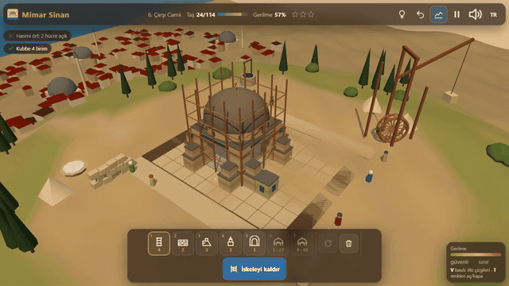
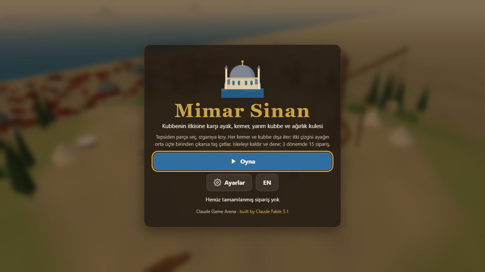
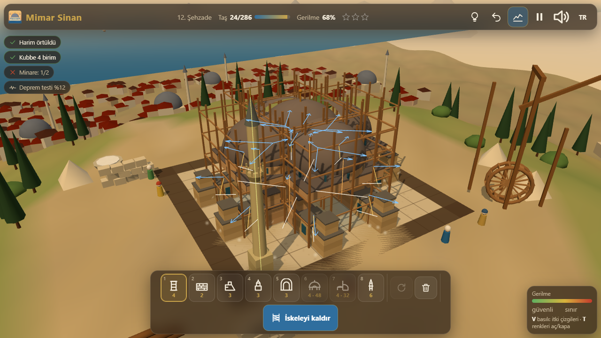
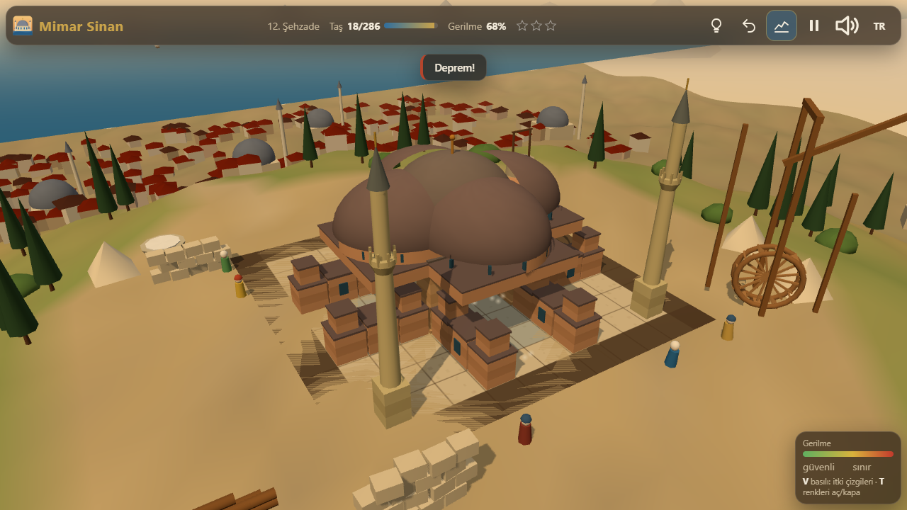
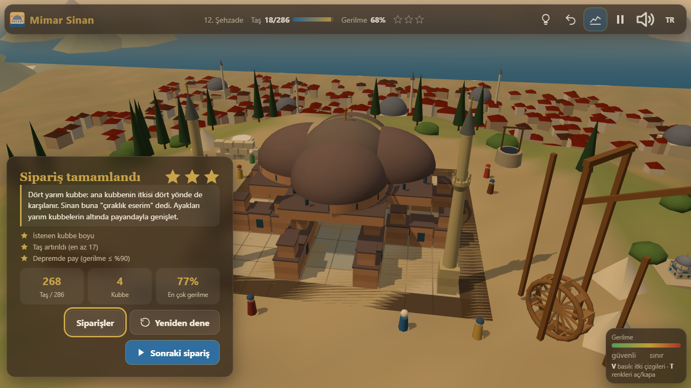
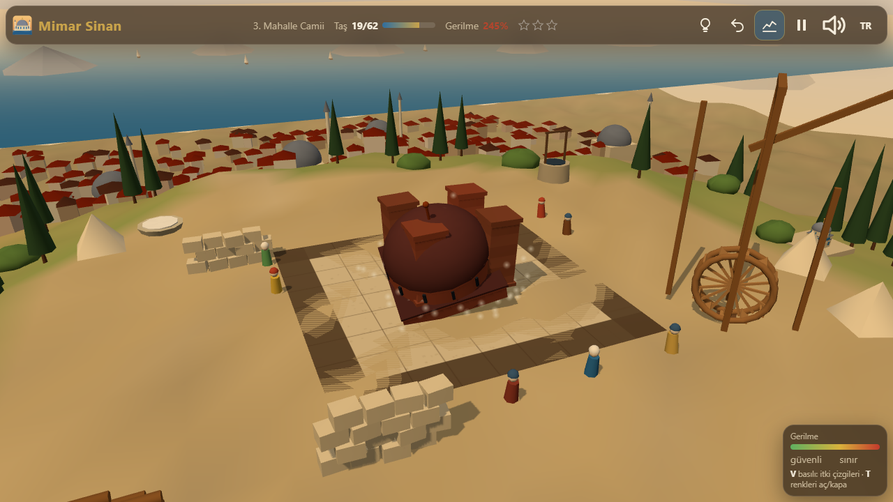
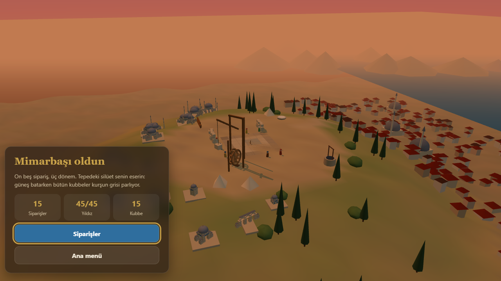
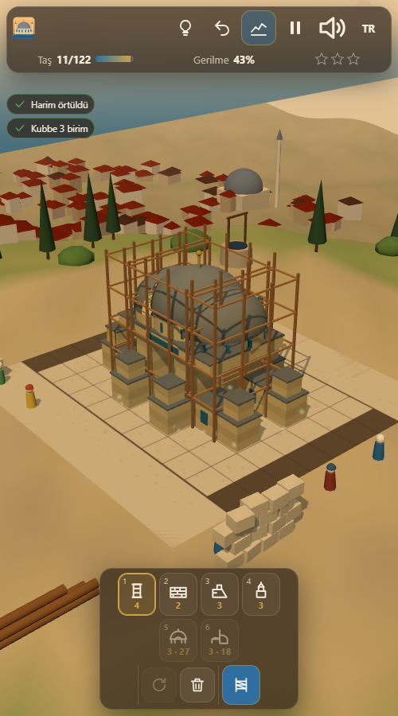

<p align="center">
  <a href="https://furkiozknn.github.io/mimar-sinan/"></a>
</p>

<p align="center">
  <a href="https://furkiozknn.github.io/mimar-sinan/"></a>
  
  
  <a href="LICENSE"></a>
  
</p>

<p align="center"><b>A 3D construction-physics puzzle about building Ottoman mosques: place piers, arches, half-domes, buttresses and weight towers on a hill above the city, then remove the scaffolding and watch the thrust lines decide whether the dome stands.</b></p>

<p align="center">
  
</p>

<p align="center"><b>Play online: <a href="https://furkiozknn.github.io/mimar-sinan/">https://furkiozknn.github.io/mimar-sinan/</a></b> (desktop and phone, no install)</p>

<!-- portals:start -->
<p align="center">Also on: <a href="https://furkiozknn.itch.io/mimar-sinan">itch.io</a></p>
<!-- portals:end -->

## Highlights

- **A real masonry simulation, written from scratch.** Every arch, dome and half-dome pushes outward; the game sums the
  thrust vectors on every pier and wall, adds the self-weight, the weight towers and the attached buttresses, and checks
  the classic *middle-third rule*: when the resultant leaves the middle third of the pier's base, the stone cracks and
  the piece falls. Piers can also be crushed. There is no physics library; the same pure functions run for the player,
  the hint, the bot and the Node test (`node test-levels.js`).
- **Sinan's lessons are the real solutions.** Half-domes take the main dome's thrust and carry it to low walls,
  weight towers pull the resultant back inside a slender pier, buttresses hide behind walls and inside side galleries,
  stepped buttresses carry the heavy thrust of a five-unit dome, and an octagon of eight piers halves the thrust on
  each one. A weight tower can even work against you in an earthquake.
- **15 commissions in 3 periods.** Apprentice (village mescit, portico, first buttresses, windows that must stay open,
  the Bayezid lesson), journeyman (a four-unit dome, minarets, the first earthquake, side galleries, eight piers) and
  master (Rüstem Paşa, Şehzade, Mihrimah Sultan, Süleymaniye, Selimiye). Each one has a footprint, a stone budget, a
  target dome size and sometimes open windows, minarets or an earthquake test.
- **Every level is provably solvable.** Each commission carries a reference solution that the same simulation must
  pass when the game loads; the hint (`H`) shows its next piece as a ghost. Stress is shown live as a green → yellow →
  red overlay while you build; hold `V` to see the thrust arrows, the thrust line inside each pier and its middle third.
- **Collapse you can watch.** Failing pieces crack, tip over in the direction of the thrust, scatter debris and dust,
  and anything they carried comes down with them. Late commissions shake the ground for a few seconds.
- **A growing skyline.** Every finished mosque is rebuilt as a small model on the hill around the site; the ending
  circles the whole skyline at sunset.
- **Played by a bot.** `?auto` builds every reference solution through the same placement API as a player and tests
  it. Measured: **15/15 commissions, 45/45 stars, 0 JS errors**, 60 fps on an Intel UHD 620 at 1280×720, 34-56 draw
  calls during play (24-26 on the title and ending screens).
- **One file, made in code.** One `index.html` with Three.js r170 from a CDN; every mesh, texture, icon and sound
  (chisel taps, crane creak, stone thuds, cracks, the earthquake rumble, a ney-and-kudüm loop) is generated in code.

## How to play

> [!TIP]
> **Goal:** roof the hall (the blue cells) with a dome of the asked size, keep the windows open, raise the minarets,
> stay within the stone budget, then remove the scaffolding. Three stars per commission: the asked dome size, stone
> left over, and a safety margin (stress ≤ 80 %, or ≤ 90 % in an earthquake).

Pick a piece from the tray at the bottom and click a cell. Piers (tall), walls (low) and buttresses stand on the
ground; arches span two piers; domes sit on four corner supports of equal height (any extra pier under the rim shares
the load); a half-dome leans on two piers of the main dome and comes down on two outer supports; a weight tower goes on
top of a pier; a minaret only needs its own cell. The stone counter in the top bar is what you have left. The colour
of each piece is its stress; the number in the top bar is the worst one. Press `Space` to remove the scaffolding.

<details>
<summary><b>The structural model</b></summary>

- A pier is a rectangular block of width 1 and height 2 (walls 1, buttresses 1.5); every load is applied at its top.
- An arch of weight *W* pushes each end outward with 0.3 *W*. A dome of size *s* weighs 4 *s*², and pushes outward
  with a share (0.08 *s* + 0.10) of its weight, split evenly between the supports under its rim and aimed radially from
  its centre. A half-dome weighs half a dome; its outer supports take 0.8 of a full dome's corner share, and the axial
  component of that push comes back on the flat edge, where it cancels the main dome's thrust.
- The overturning moment at the base is *M* = |*H*| · *h* (plus the earthquake: ground acceleration × every mass ×
  its height). The eccentricity *e* = *M* / *N* must stay inside the kern: *b* / 6 for a bare pier, wider when a wall
  (0.3) or a buttress (0.6, 0.8 less per further step) is attached on the side the thrust pushes toward.
- Compression: *N* / capacity (pier 56, wall 32, minaret 30). Helpers add weight to the overturning check but stand on
  their own footing.
- A support that fails takes every piece it carries down with it. Minarets are cramped with iron and sway in a quake.

</details>

### Controls

| Action | Mouse / touch | Keyboard |
|---|---|---|
| Place the selected piece | click / tap a cell | |
| Select a piece | tray | `1`-`9` |
| Rotate (arches, half-domes) | tray button, two-finger twist | `R` |
| Remove a piece | right-click, or the eraser tool | `Del` over a cell, `E` eraser |
| Remove the scaffolding (test) | tray button | `Space` |
| Stress colours on/off | HUD button | `T` |
| Thrust lines | | hold `V` |
| Undo / hint | HUD buttons | `Z` / `H` |
| Orbit / zoom | drag on empty ground or right-drag; wheel, pinch | |
| Pause | HUD button | `P` / `Esc` |
| Music / effects / language / fullscreen | HUD buttons | `M` / `X` / `L` / `F` |

Settings are saved in `localStorage` under `arena.mimar.settings`; stars, the current commission and the finished
layouts (which also rebuild the skyline) under `arena.mimar.save`, the best star total under `arena.mimar.best`.
Turkish is the default language (English when the browser is not Turkish); phones start on the Low tier.

<details>
<summary><b>URL flags for testing</b></summary>

| Flag | Effect |
|---|---|
| `?auto` | the bot plays every commission |
| `?debug` | fps, draw calls and errors on screen; `window.mimarSim(seconds)` fast-forwards |
| `?sim=N` | fast-forward N seconds before the first frame |
| `?low` | shadows off, half the particles |
| `?lang=en` | English |
| `?level=N` | start a commission directly |
| `?nosave` | do not read or write progress |
| `?noassets` | accepted; there are no asset files, so nothing changes |
| `?botdelay=0.3` | seconds between the bot's placements (default 0.12) |

The live state is on `window.mimar`.

</details>

## Screenshots

<table>
  <tr>
    <td width="33%"><br><sub>Title screen</sub></td>
    <td width="33%"><br><sub>Building Şehzade, thrust lines on</sub></td>
    <td width="33%"><br><sub>The earthquake test</sub></td>
  </tr>
  <tr>
    <td><br><sub>Commission complete</sub></td>
    <td><br><sub>A collapse</sub></td>
    <td><br><sub>Ending: the skyline at sunset</sub></td>
  </tr>
  <tr>
    <td><br><sub>On a phone</sub></td>
    <td></td>
    <td></td>
  </tr>
</table>

## Running locally

Serve the folder over HTTP, for example:

```
python -m http.server 8000
```

then open <http://localhost:8000/>.

## How it was made

Built by Claude Fable 5.1 with Claude Code from one prompt: [`prompts/mimar-sinan.md`](prompts/mimar-sinan.md).
`sim.js` holds the simulation and the commission data that are inlined into `index.html`; `node test-levels.js` checks
every reference solution (all 15 pass under gravity and the earthquake test) and `node calib.js` prints the stress of
canonical layouts. Everything else is generated in code, so there are no asset files and no credits to list.

Facts in the commission notes: Sinan called Şehzade (1548) his apprentice work; Süleymaniye (1557) uses two half-domes
and stepped buttresses hidden in the side galleries; Selimiye (1575), his masterpiece, puts one great dome on eight
piers. The thrust-line and middle-third ideas are the classic graphical statics of masonry; the numbers in the game are
tuned for play, not for engineering.

Mimar Sinan is part of the **Claude Game Arena** series, where each game is built by a Claude model from one prompt.
The other games: [Hisar](https://furkiozknn.github.io/kale-savunmasi/) ·
[Çay Ocağı](https://furkiozknn.github.io/cay-ocagi/) · [Çini Ustası](https://furkiozknn.github.io/cini-ustasi/) ·
[Martı](https://furkiozknn.github.io/marti/) · [Kervan](https://furkiozknn.github.io/kervan/) ·
[Dolmuş](https://furkiozknn.github.io/dolmus/) · [Peri Golf](https://furkiozknn.github.io/peri-golf/) ·
[Mehter](https://furkiozknn.github.io/mehter/) · [Boğaz Vapuru](https://furkiozknn.github.io/bogaz-vapuru/) ·
[Simit Fırını](https://furkiozknn.github.io/simit-firini/) · [Karagöz](https://furkiozknn.github.io/karagoz/) ·
[Lale Bahçesi](https://furkiozknn.github.io/lale-bahcesi/)

**Round 5:** [Kapadokya Balonu](https://furkiozknn.github.io/kapadokya-balonu/) ·
[Ebru](https://furkiozknn.github.io/ebru/) · [Kırkpınar](https://furkiozknn.github.io/kirkpinar/) ·
[Çarşı Kaçışı](https://furkiozknn.github.io/carsi-kacisi/)

**Round 6:** [Topkapı Gecesi](https://furkiozknn.github.io/topkapi-gecesi/) · [Hamsi](https://furkiozknn.github.io/hamsi/) ·
[Pamukkale](https://furkiozknn.github.io/pamukkale/) · **Mimar Sinan**

## Türkçe

**Mimar Sinan**, Osmanlı camileri inşa ettiğin 3D yapı fiziği bulmacası. Şehrin üstündeki tepede ayak, kemer, yarım
kubbe, payanda ve ağırlık kulesi yerleştirirsin; sonra iskeleyi kaldırırsın ve itki çizgileri kubbenin ayakta kalıp
kalmayacağına karar verir. 3 dönemde 15 sipariş, her birinde 3 yıldız; bazılarında deprem testi var. Kurulum yok;
masaüstünde ve telefonda tarayıcıda oynanır. Claude Fable 5.1 tarafından Claude Code ile tek bir prompt'tan yapıldı.

**Oyna:** https://furkiozknn.github.io/mimar-sinan/

## License

MIT, see [LICENSE](LICENSE).

Like the game? You can support new rounds on [Buy Me a Coffee](https://buymeacoffee.com/furkiozkann). The game stays free.
