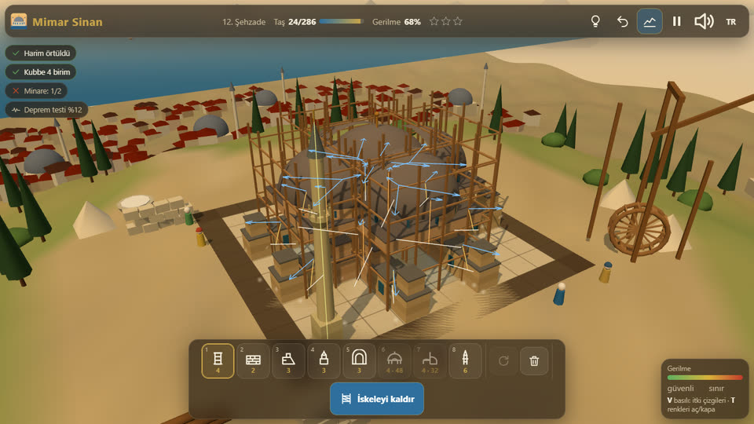
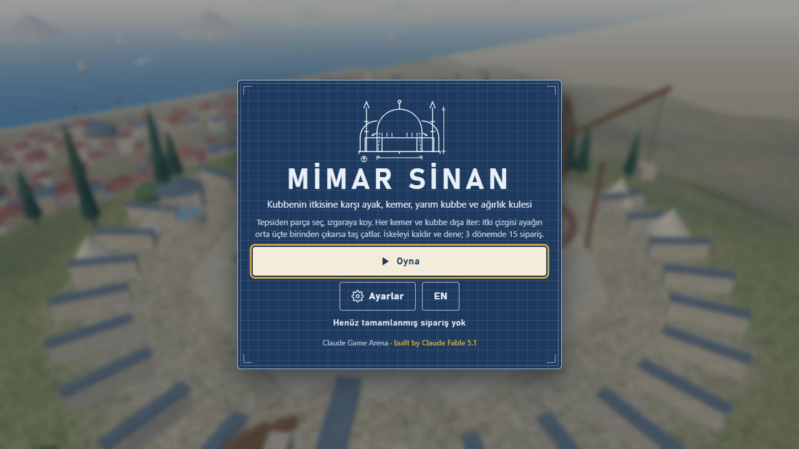
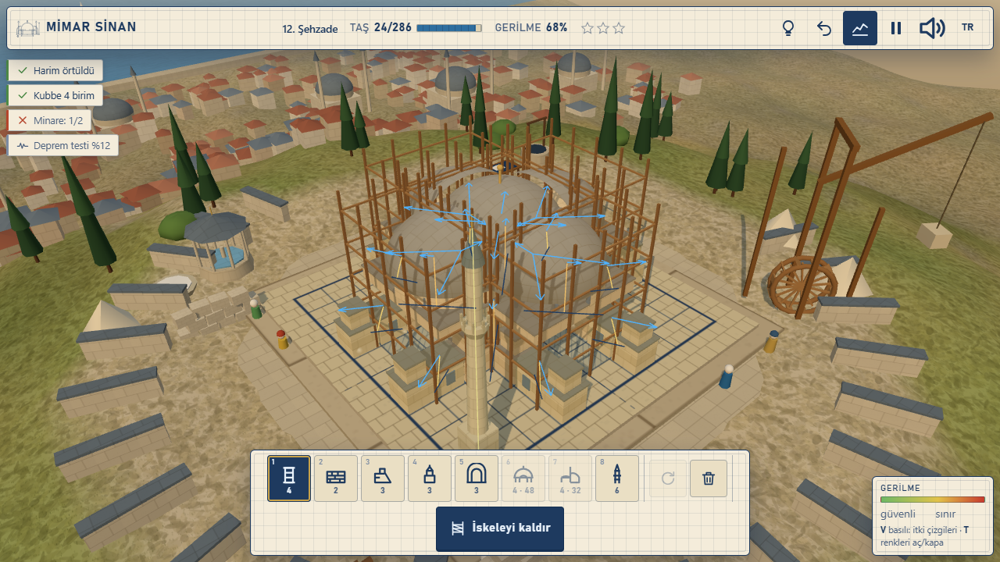
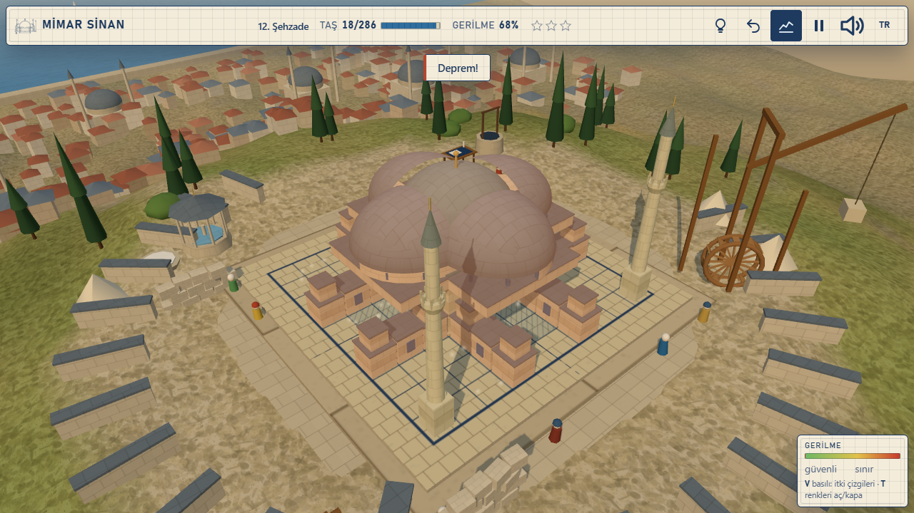
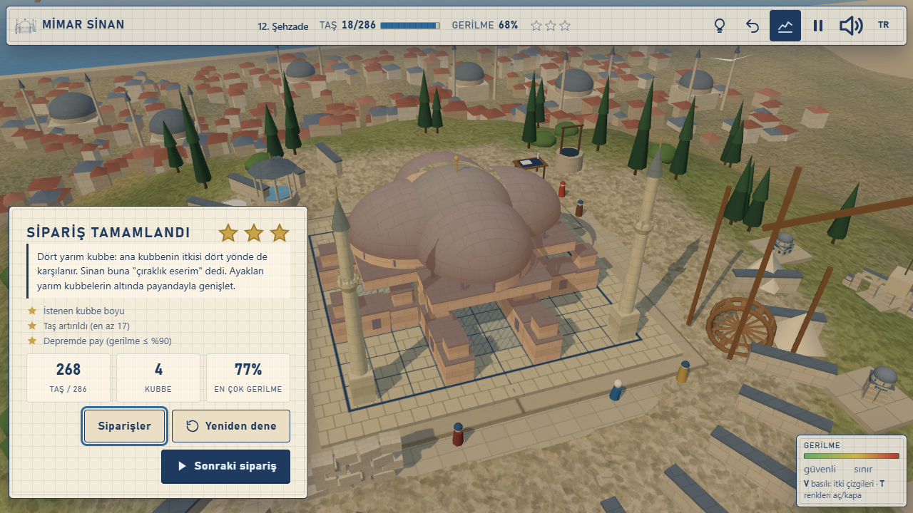
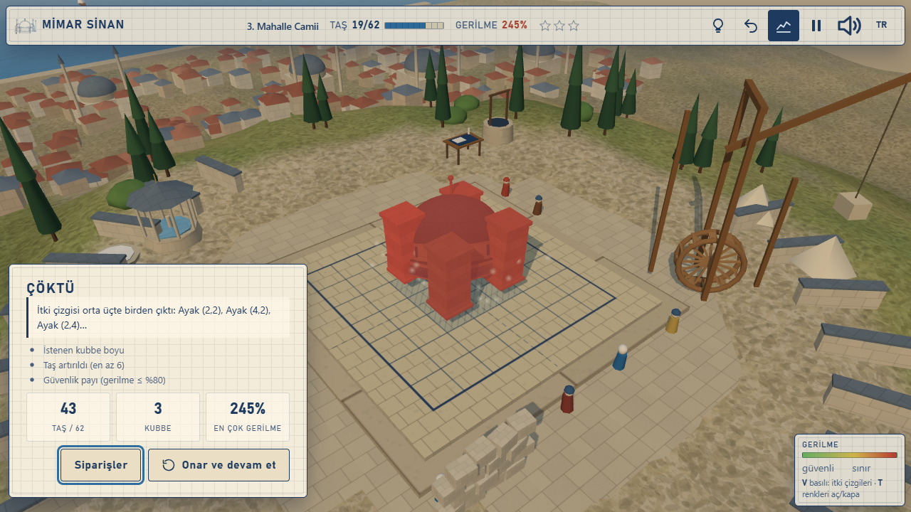
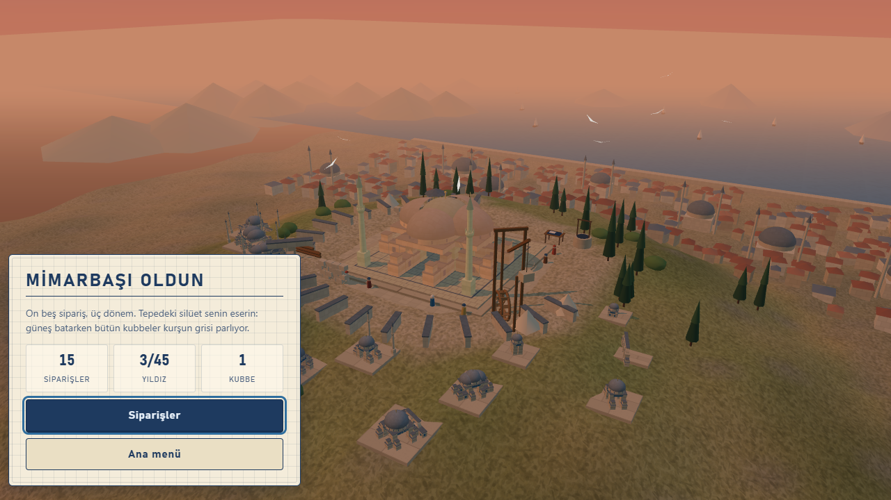
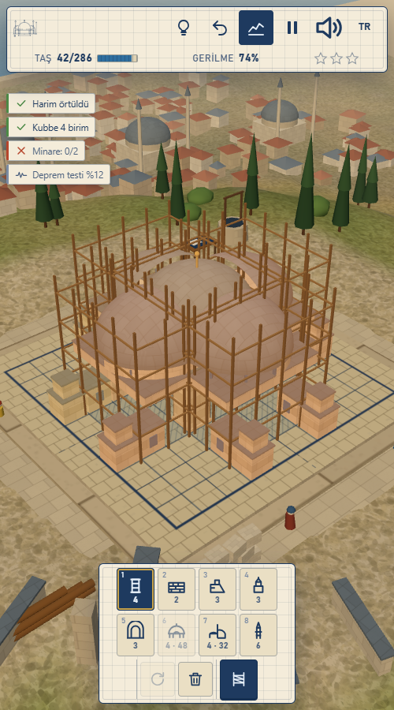
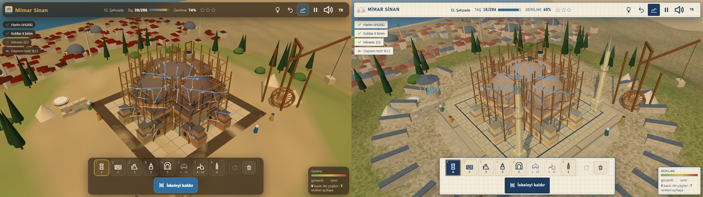

<p align="center">
  <a href="https://furkiozknn.github.io/mimar-sinan/">
    
  </a>
</p>

<p align="center">
  <a href="https://furkiozknn.github.io/mimar-sinan/"></a>
</p>

<p align="center">
  
  
  <a href="LICENSE"></a>
  
</p>

<!-- portals:start -->
<p align="center">
  Also on: <a href="https://furkiozknn.itch.io/mimar-sinan"><strong>itch.io</strong></a>
</p>
<!-- portals:end -->

<p align="center">
  <strong>A 3D construction-physics puzzle about building Ottoman mosques: place piers, arches, half-domes, buttresses and weight towers on a hill above the city, then remove the scaffolding and watch the thrust lines decide whether the dome stands.</strong>
</p>

<!-- gameplay gif -->

## Features

- **15 commissions across 3 historical eras:** Advance through Apprentice (village mescit, portico, Bayezid lesson), Journeyman (4-unit dome, minarets, first earthquake test, 8 piers), and Master (Rüstem Paşa, Şehzade, Mihrimah Sultan, Süleymaniye, Selimiye), aiming for 3 stars per level across 45 total stars.
- **Authentic masonry statics simulation:** A custom pure JavaScript statics engine summing real thrust vectors against the classic middle-third rule—calculating arch thrust (0.3 *W*), dome outward push ((0.08 *s* + 0.10) *W*), half-dome counter-thrust, and compression limits (pier 56, wall 32, minaret 30) without external physics libraries.
- **Sinan's architectural engineering:** Master authentic Ottoman solutions where half-domes absorb outward thrust, weight towers pull resultant vectors back inside slender piers, stepped buttresses brace 5-unit domes, and octagonal 8-pier layouts halve the thrust on each pier.
- **Dynamic diagnostics & collapse FX:** Watch overstressed pieces crack, tip over about their base edge, scatter dust, and bring down what they carry; inspect live stress (green &rarr; yellow &rarr; red), hold `V` to visualize live thrust vectors and middle-third kern lines, or press `H` for ghost-block hints.
- **Ultra-lean web performance:** A single self-contained `index.html` running Three.js r170 delivering steady 60 fps on Intel UHD 620 (33–66 draw calls across gameplay and earthquake tests; 380 textured houses and 7 domed mosques in the city), verified by an automated bot across 15/15 commissions and 45/45 stars with 0 JS errors.

## How to play

> [!TIP]
> **Goal:** Roof the hall (the blue cells) with a dome of the target size, keep windows open, raise minarets, stay within the stone budget, then remove the scaffolding. Earn up to 3 stars per commission: target dome size, stone left over, and a safety margin (stress &le; 80%, or &le; 90% in an earthquake).

1. **Choose and place pieces:** Pick a structural piece from the bottom tray (`1`–`9`) and click a cell. Piers, walls, and buttresses stand on the ground; arches span two piers; domes rest on four corner supports; half-domes lean against the main dome; weight towers cap piers; minarets need their own cell.
2. **Monitor stone & stress:** Track your remaining stone budget in the top bar. Stress displays live as color tints (green &rarr; yellow &rarr; red); toggle stress views with `T` or hold `V` to inspect thrust vectors and middle-third kern boundaries inside each pier.
3. **Test the structure (`Space`):** Remove the scaffolding and watch gravity—and in late commissions, earthquake tremors—test your masonry. If resultant thrust stays inside the middle third, the mosque stands and earns up to 3 stars.

<details>
<summary><b>The structural model</b></summary>

- A pier is a rectangular block of width 1 and height 2 (walls 1, buttresses 1.5); every load is applied at its top.
- An arch of weight *W* pushes each end outward with 0.3 *W*. A dome of size *s* weighs 4 *s*², and pushes outward with a share (0.08 *s* + 0.10) of its weight, split evenly between the supports under its rim and aimed radially from its centre. A half-dome weighs half a dome; its outer supports take 0.8 of a full dome's corner share, and the axial component of that push comes back on the flat edge, where it cancels the main dome's thrust.
- The overturning moment at the base is *M* = |*H*| · *h* (plus the earthquake: ground acceleration × every mass × its height). The eccentricity *e* = *M* / *N* must stay inside the kern: *b* / 6 for a bare pier, wider when a wall (0.3) or a buttress (0.6, 0.8 less per further step) is attached on the side the thrust pushes toward.
- Compression: *N* / capacity (pier 56, wall 32, minaret 30). Helpers add weight to the overturning check but stand on their own footing.
- A support that fails takes every piece it carries down with it. Minarets are cramped with iron and sway in a quake.

</details>

### Controls

| Action | Mouse / touch | Keyboard |
|---|---|---|
| Place the selected piece | Click / tap a cell | |
| Select a piece | Tray | `1`–`9` |
| Rotate (arches, half-domes) | Tray button, two-finger twist | `R` |
| Remove a piece | Right-click, or eraser tool | `Del` over a cell, `E` eraser |
| Remove scaffolding (test) | Tray button | `Space` |
| Stress colours on/off | HUD button | `T` |
| Thrust lines | | Hold `V` |
| Undo / hint | HUD buttons | `Z` / `H` |
| Orbit / zoom | Drag empty ground / right-drag; wheel, pinch | |
| Pause | HUD button | `P` / `Esc` |
| Music / effects / language / fullscreen | HUD buttons | `M` / `X` / `L` / `F` |

- **Audio & display:** HUD buttons control music (`M`), sound effects (`X`), language (`L`), and fullscreen (`F`).
- **Touch & camera:** Orbit by dragging empty ground or right-dragging; pinch or scroll wheel to zoom; two-finger twist to rotate pieces.
- **Persistence:** Settings are saved in `localStorage` under `arena.mimar.settings`; stars, the current commission, and finished layouts (which rebuild the skyline) under `arena.mimar.save`; best star total under `arena.mimar.best`. Turkish is the default language (English when the browser is not Turkish); phones start on the Low tier.

<details>
<summary><b>URL flags for testing</b></summary>

| Flag | Effect |
|---|---|
| `?auto` | The bot plays every commission |
| `?debug` | FPS, draw calls, and errors on screen; `window.mimarSim(seconds)` fast-forwards |
| `?sim=N` | Fast-forward N seconds before the first frame |
| `?low` | Shadows off, half the particles |
| `?lang=en` | English |
| `?level=N` | Start a commission directly |
| `?nosave` | Do not read or write progress |
| `?noassets` | Accepted; there are no asset files, so nothing changes |
| `?botdelay=0.3` | Seconds between the bot's placements (default 0.12) |

The live state is on `window.mimar`.

</details>

## Screenshots

<table>
  <tr>
    <td width="33%"><br><sub>Title screen</sub></td>
    <td width="33%"><br><sub>Building Şehzade, thrust lines on</sub></td>
    <td width="33%"><br><sub>The earthquake test</sub></td>
  </tr>
  <tr>
    <td><br><sub>Commission complete</sub></td>
    <td><br><sub>A collapse</sub></td>
    <td><br><sub>Ending: the skyline at sunset</sub></td>
  </tr>
  <tr>
    <td><br><sub>On a phone</sub></td>
    <td></td>
    <td></td>
  </tr>
</table>

## Redesign & Performance

**Art direction: blueprint + warm limestone.** The site is an architect's drawing come to life: the plan is inked in blueprint blue on a flagstone plinth, the building rises in running-bond limestone ashlar under lead domes, and the city and the sea lie below in afternoon haze. The UI is drafting paper with blue ink; the title card is the blueprint sheet itself, with a line-drawn section of the mosque, dimension lines, and a north arrow.

**Visual updates (gameplay, levels, scoring, saves, the bot, and flags are untouched):**
- **Palette and light:** Limestone `#E3D5B8`, lead `#6E7B85`, İznik blue `#2F6E9E`, blueprint `#1E3A5F`, line white `#E8F1FA`. Lower, warmer sun with longer shadows, a glow around the sun, a sky that brightens toward it, denser warm fog so the city and the sea dissolve into haze; the ending turns to sunset.
- **Environment:** Mottled earth texture on the hill with scrub patches and rocky outcrops; a sunken paved forecourt the plinth and its steps stand proud of; a forecourt wall with an arched gate; an ablution fountain, the architect's drafting table with a blueprint, more cypresses; a bigger city (380 textured houses, 7 domed mosques with minarets, a quay); pale afternoon water with drifting streaks and a glitter band; gulls circling above the site.
- **Pieces:** Every piece gets a box-projected running-bond ashlar texture at world scale (one tile per unit), so piers, walls, arches, and drums read as cut stone; lead domes keep a light-to-dark gradient with sheet seams. Stress colours are a light tint plus a warm glow instead of a brown multiply; failing pieces still turn red.
- **Animation and FX:** Placed pieces drop in and settle; ground pieces that fail tip over about their base edge in the direction of the thrust (minarets fall like trees) before debris and dust scatter; the sea texture drifts.
- **UI:** Drafting-paper panels (faint grid, blue rule, inner frame) with Bahnschrift / DIN-style headings and tabular numbers, a ruler-style stone budget, blueprint title sheet with corner marks, paper piece tray with blue-ink icons, blueprint-blue primary buttons. Every screen is restyled: title, commissions, brief, pause, settings, result, ending, toasts, legend, and requirement chips. Phone portrait and landscape checked at 500×900.

**Measured on an Intel UHD 620 (headless Chrome, 1280×720):**
- Draw calls: title 25 &rarr; 33, Şehzade build 53 &rarr; 65, earthquake test 58 &rarr; 66, Süleymaniye build 54 &rarr; 62, ending 62 &rarr; 67
- Page rAF: 60 fps throughout, before and after
- Automated bot test: `?auto` bot finishes 15/15 commissions with 45/45 stars and 0 JS errors, with assets and with `?noassets`
- Reference solutions: `node test-levels.js` passes all 15 reference solutions under gravity and earthquake



## Running locally

Serve the folder over HTTP (ES modules do not load from `file://`):

```bash
python -m http.server 8000
```

Then open <http://localhost:8000/>.

## Made with Claude Code

Built by **Claude Fable 5.1** with Claude Code from one prompt: [`prompts/mimar-sinan.md`](prompts/mimar-sinan.md). `sim.js` holds the simulation and the commission data that are inlined into `index.html`; `node test-levels.js` checks every reference solution (all 15 pass under gravity and the earthquake test) and `node calib.js` prints the stress of canonical layouts. Everything else is generated in code, so there are no asset files and no credits to list.

Facts in the commission notes: Sinan called Şehzade (1548) his apprentice work; Süleymaniye (1557) uses two half-domes and stepped buttresses hidden in the side galleries; Selimiye (1575), his masterpiece, puts one great dome on eight piers. The thrust-line and middle-third ideas are the classic graphical statics of masonry; the numbers in the game are tuned for play, not for engineering.

### Claude Game Arena

Mimar Sinan is part of the **Claude Game Arena** series, where each game is built by a Claude model from one prompt.

[Hisar](https://furkiozknn.github.io/kale-savunmasi/) · [Çay Ocağı](https://furkiozknn.github.io/cay-ocagi/) · [Çini Ustası](https://furkiozknn.github.io/cini-ustasi/) · [Martı](https://furkiozknn.github.io/marti/) · [Kervan](https://furkiozknn.github.io/kervan/) · [Dolmuş](https://furkiozknn.github.io/dolmus/) · [Peri Golf](https://furkiozknn.github.io/peri-golf/) · [Mehter](https://furkiozknn.github.io/mehter/) · [Boğaz Vapuru](https://furkiozknn.github.io/bogaz-vapuru/) · [Simit Fırını](https://furkiozknn.github.io/simit-firini/) · [Karagöz](https://furkiozknn.github.io/karagoz/) · [Lale Bahçesi](https://furkiozknn.github.io/lale-bahcesi/)

**Round 5:** [Kapadokya Balonu](https://furkiozknn.github.io/kapadokya-balonu/) · [Ebru](https://furkiozknn.github.io/ebru/) · [Kırkpınar](https://furkiozknn.github.io/kirkpinar/) · [Çarşı Kaçışı](https://furkiozknn.github.io/carsi-kacisi/)

**Round 6:** [Topkapı Gecesi](https://furkiozknn.github.io/topkapi-gecesi/) · [Hamsi](https://furkiozknn.github.io/hamsi/) · [Pamukkale](https://furkiozknn.github.io/pamukkale/) · **Mimar Sinan**

## License

MIT, see [LICENSE](LICENSE).

Like the game? You can support new rounds on [Buy Me a Coffee](https://buymeacoffee.com/furkiozkann). The game stays free.
